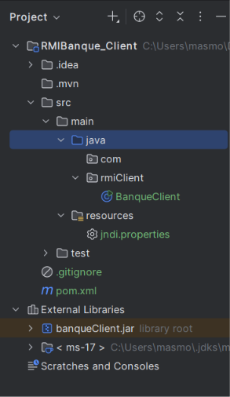
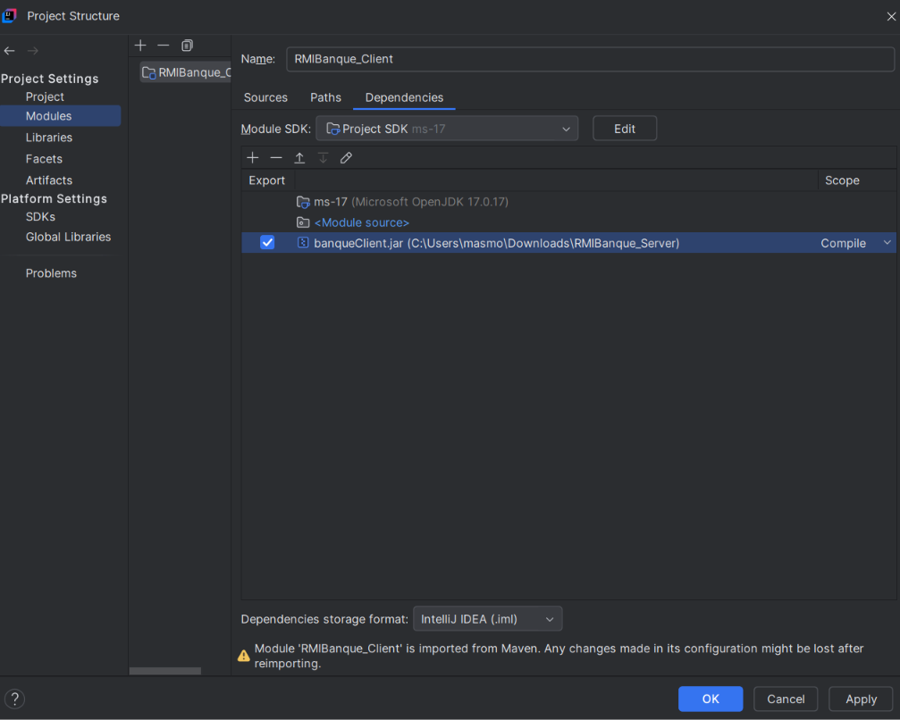
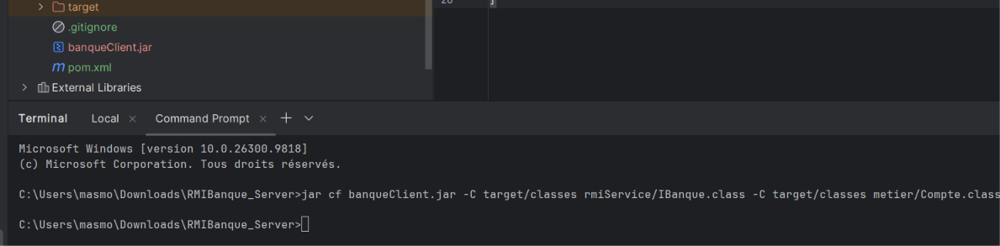
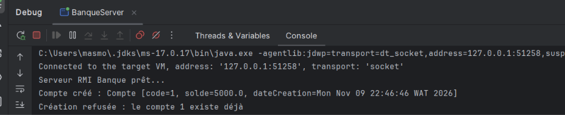
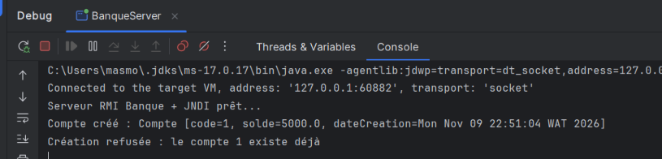

# RMIBanque_Server

**TP5 – Activité 5-2 : Service de banque avec Java RMI et JNDI**

Projet **serveur** : il gère les comptes bancaires (code, solde, date de création) et expose à distance deux services :
- `creerCompte(Compte c)` : crée un compte si son code n'existe pas déjà ;
- `getInfoCompte(int code)` : consulte un compte à partir de son code.

## jndi.properties
```
java.naming.factory.initial=com.sun.jndi.rmi.registry.RegistryContextFactory
java.naming.provider.url=rmi://localhost:1099
```

## Imprimés écran

### Étape 2 – Développement du serveur : structure du projet


### Configuration du projet (modules)


### Étape 3 – Génération de `banqueClient.jar` (IBanque + Compte, sans BanqueImpl)


### Étape 4 – Exécution avec le registre RMI direct (`Naming`)


### Étape 5 – Exécution avec JNDI (`InitialContext`)


## Exécution
1. Compiler le projet.
2. Lancer `rmiServer.BanqueServer`.
3. Message attendu : `Serveur RMI Banque + JNDI prêt...`
4. Laisser le serveur actif, puis lancer le client (projet `RMIBanque_Client`).

## Synthèse

Cette activité met en œuvre une application répartie avec **Java RMI** : le client appelle des méthodes d'un objet situé dans une autre JVM comme s'il était local.

- **`Compte`** (package `metier`) est **Serializable** : il est passé en paramètre d'une méthode distante, RMI le sérialise pour le transmettre au serveur (passage par valeur).
- **`IBanque`** (package `rmiService`) est l'interface distante : elle étend `Remote` et chaque méthode déclare `RemoteException`, car un appel réseau peut échouer.
- **`BanqueImpl`** étend `UnicastRemoteObject` : elle contient le vrai code (comptes stockés dans une `Map`, refus de création si le code existe déjà) et est exportée automatiquement.
- **`BanqueServer`** démarre le registre RMI (port 1099) et publie l'objet.
- **`banqueClient.jar`** ne contient que `IBanque` et `Compte` : le client n'a jamais accès à `BanqueImpl`.

**Passage à JNDI (étape 5).** Au lieu d'utiliser directement `Naming`, le serveur fait `InitialContext.rebind("banque", ...)`. L'adresse de l'annuaire n'est plus écrite dans le code mais dans `jndi.properties` (`java.naming.factory.initial` et `java.naming.provider.url`). Le code est ainsi indépendant de l'annuaire utilisé : on peut en changer par simple configuration. Le fonctionnement reste identique avant et après JNDI (création, refus d'un doublon, consultation d'un compte existant et inexistant).

